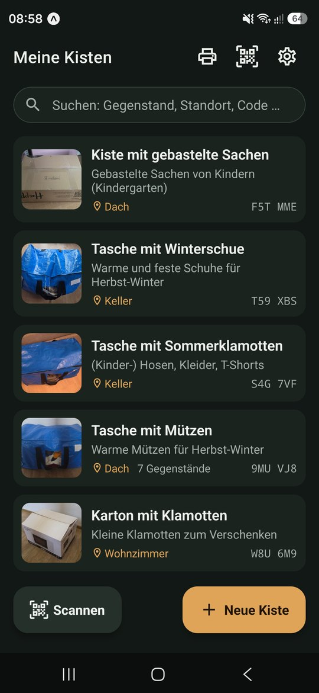
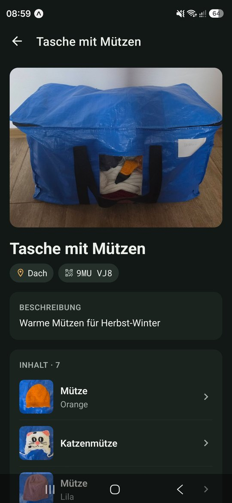
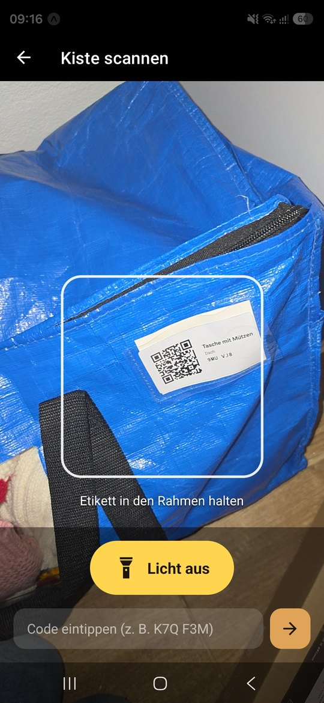
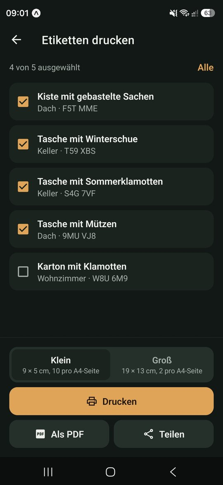
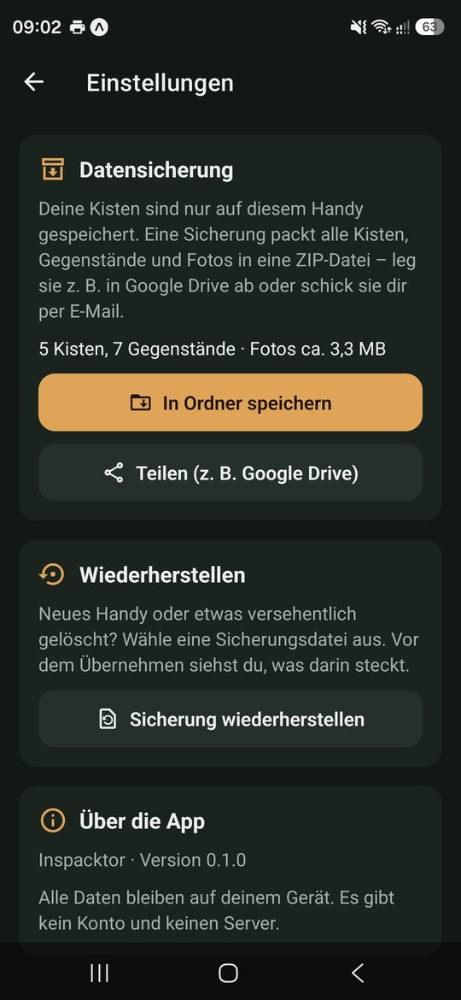
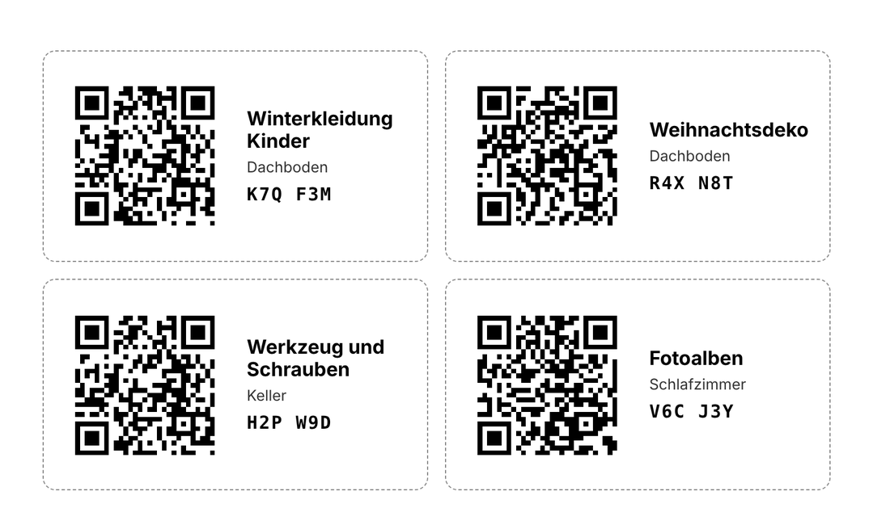

<p align="center">
  
</p>

<h1 align="center">Inspacktor</h1>

<p align="center">
  <strong>Scannen statt suchen.</strong><br>
  Kisten mit Foto und Inhalt erfassen, QR-Etikett draufkleben –<br>
  und später mit einem Scan sehen, was drin ist. Auch im Dunkeln.
</p>

<p align="center">
  <a href="https://github.com/anatolij-imgrund/Inspacktor/actions/workflows/ci.yml"></a>
  
  
  
  
</p>

---

## Worum es geht

Auf dem Dachboden, im Keller oder in der Garage stapeln sich Kisten: Winterkleidung
der Kinder, Weihnachtsdeko, Werkzeug, Erinnerungen. Was wo drin ist, weiß man
selten genau. Also werden Kisten geöffnet, durchwühlt und wieder zugeklebt.

Inspacktor dreht das um. Beim Einpacken fotografiert man jeden Gegenstand und
notiert kurz, was es ist, z. B. „Winterjacke, Gr. 116, blau“. Die App druckt
dazu ein QR-Etikett für die Kiste. Später reicht ein Scan, und der Inhalt
steht auf dem Bildschirm. Oder man sucht gleich in der App nach „Jacke 116“
und erfährt, in welcher Kiste sie liegt.

Der Name ist ein Wortspiel aus *Inspektor* und *packen*.

## Screenshots

<p align="center">
  
  
  
  
  
</p>
<p align="center"><sub>Echte Kisten und Taschen von Dachboden und Keller; der Scanner liest ein gedrucktes Etikett in einer Schutzhülle.</sub></p>

## Funktionen

**Kisten und Inhalt**
- Kiste mit Foto, Titel, Standort und allgemeiner Beschreibung anlegen
- Darin beliebig viele Gegenstände, jeder mit eigenem Foto, Beschreibung und
  Menge („3 × Socken“)
- „Speichern und nächsten“: Gegenstände beim Einpacken Stück für Stück erfassen
- Gegenstände in eine andere Kiste verschieben, wenn man umpackt
- Standort-Schnellauswahl aus den bisher benutzten Orten

**Suchen**
- Eine Suche über Kisten und alle Gegenstände darin, unabhängig von
  Groß- und Kleinschreibung und auch mit Umlauten
- Mehrere Wörter grenzen ein: „dach jacke“ findet die Kiste auf dem Dach mit
  der Jacke darin
- Trefferliste zeigt, welche Gegenstände gepasst haben („enthält: Winterjacke“)

**QR-Etiketten**
- Jede Kiste bekommt einen kurzen Code ohne verwechselbare Zeichen (kein 0/O, 1/I/L),
  zum Abtippen, falls ein Etikett beschädigt ist
- Zwei Größen: klein (9 × 5 cm, 10 pro A4-Seite) und groß (19 × 13 cm, 2 pro Seite)
- Drucken, als PDF in einen beliebigen Ordner speichern oder teilen
- Sammelbogen: mehrere Kisten auswählen und auf einem Bogen drucken

**Scannen**
- Etikett in die Kamera halten, die Kiste öffnet sich, mit Vibration als Bestätigung
- **Taschenlampe an/aus** direkt im Scanner, für Dachboden und Keller
- „Zurück“ führt wieder zum Scanner, um mehrere Kisten nacheinander zu prüfen
- Auch die normale Handy-Kamera öffnet die App über den QR-Code

**Datensicherung**
- Alle Kisten, Gegenstände **und Fotos** in einer ZIP-Datei, in einen Ordner
  oder über Google Drive, E-Mail …
- Wiederherstellen mit Vorschau: „Ergänzen“ übernimmt nur neue Kisten,
  „Ersetzen“ tauscht alles aus
- Ganz oder gar nicht: Bei einem Fehler bleibt der alte Stand erhalten

**Darstellung**
- Hell und dunkel nach Einstellung des Handys

<details>
<summary><strong>Beispiel: Etikettenbogen</strong> (erfundene Daten)</summary>
<p align="center"></p>
</details>

## Datenschutz

Alle Daten bleiben auf dem Handy. Inspacktor hat **kein Konto, keinen Server
und keine Werbung**, und ich als Entwickler erhalte keine Daten. Einzige
Ausnahme: Der QR-Scanner nutzt unter Android Google ML Kit, das Google
technische Nutzungs- und Leistungsdaten senden kann. Kamerabilder und
gescannte Codes bleiben auf dem Handy.
Details in der [Datenschutzerklärung](https://anatolij-imgrund.github.io/Inspacktor/datenschutz.html).

Die App fragt nur nach einer Berechtigung, der **Kamera**, und erst dann, wenn
man zum ersten Mal scannt oder ein Foto macht. Fotos aus der Galerie wählt man
über die Bildauswahl von Android, ohne Zugriff auf alle Bilder. Ordner für PDF
und Sicherung wählt man selbst über die Ordnerauswahl von Android. Das Mikrofon
und der allgemeine Speicherzugriff sind gesperrt.

Eine Sicherung verlässt das Handy nur, wenn man sie selbst teilt.

## Technik

| Bereich | Umsetzung |
| --- | --- |
| Plattform | React Native 0.88 mit Expo SDK 58, React 19, React Compiler |
| Sprache | TypeScript im Strict-Modus, `noUncheckedIndexedAccess` |
| Navigation | Expo Router (dateibasiert) |
| Daten | SQLite über `expo-sqlite`, versionierte Migrationen |
| Formulare | `react-hook-form` mit `zod`, Meldungen auf Deutsch |
| Scanner | `expo-camera` mit Taschenlampe, Codeprüfung in eigener Logik |
| QR-Code | `qrcode-generator`, gezeichnet als SVG – in der App und im PDF |
| Etiketten | HTML-Vorlage, gerendert mit `expo-print`, geteilt mit `expo-sharing` |
| Fotos | `expo-image-picker`, verkleinert mit `expo-image-manipulator` |
| Sicherung | ZIP mit `fflate`, Ordnerzugriff über das Android-Speicher-Framework |
| Tastatur | `react-native-keyboard-controller`: Eingabefelder bleiben sichtbar |
| Qualität | `node:test` gegen echtes SQLite, ESLint typgestützt, GitHub Actions |

## Architektur

```
src/
├── app/          Bildschirme (Expo Router)
│   └── kiste/[code]/…   Kiste, Gegenstände, Bearbeiten, Verschieben
├── components/   wiederverwendbare Bausteine, Formulare, QR-Code
├── db/           Schema, Migrationen, alle SQL-Abfragen
├── lib/          Kisten-Code, QR, Etiketten, Fotos, Sicherung
└── theme/        Farben hell/dunkel, Abstände
assets/icon-quelle/   SVG-Quellen des App-Icons
docs/             Datenschutzseite (GitHub Pages) und Bilder fürs README
store/            Texte, Grafiken und Antworten für Google Play
```

Tests liegen direkt neben dem Code (`*.test.ts`).

Einige Entscheidungen, die das Projekt prägen:

- **Ein Etikett muss jahrelang funktionieren.** Der QR-Code nutzt die
  Fehlerkorrekturstufe Q, damit auch geknickte oder verschmutzte Etiketten
  lesbar bleiben. Ein Test malt jeden Code Pixel für Pixel wie ein Drucker und
  liest ihn mit einem unabhängigen Decoder (`jsQR`) zurück. Als die App von
  „Vorratsliste“ zu „Inspacktor“ umbenannt wurde, blieben alte Etiketten und
  alte Sicherungen gültig, ebenfalls durch Tests abgesichert.
- **Migrationen ganz oder gar nicht.** Jede Schemaversion läuft in einer
  eigenen Transaktion. Bricht die App mittendrin ab, bleibt die Datenbank auf
  der letzten vollständigen Version. Tests spielen Datenbanken älterer
  Versionen ein.
- **Alles von außen ist unzuverlässig.** SQL nur mit Parametern, Texte im
  Etikett werden maskiert, Sicherungsdateien vor dem Einspielen vollständig mit
  `zod` geprüft. Fotonamen aus einer Sicherung dürfen keine Pfade enthalten,
  damit eine präparierte Datei nichts außerhalb des Foto-Ordners überschreibt.
- **Logik ohne Handy testbar.** Kisten-Code, Suche, QR, Etiketten-Layout,
  Sicherung und alle Datenbankfunktionen laufen gegen das in Node eingebaute
  SQLite. Ein Test sichert eine volle Datenbank und spielt sie in eine leere
  zurück, das Ergebnis muss identisch sein.
- **Fehler werden nicht verschluckt.** ESLint verbietet Promises ohne `await`
  (`no-floating-promises`).

## Selbst ausprobieren

Voraussetzungen: Node.js 22.13 oder neuer, ein Android-Handy mit
[Expo Go](https://expo.dev/go) oder ein Emulator aus Android Studio.

```bash
git clone https://github.com/anatolij-imgrund/Inspacktor.git
cd Inspacktor
npm ci
npx expo start
```

QR-Code mit Expo Go scannen.

```bash
npm test            # Tests
npm run typecheck   # TypeScript
npm run lint        # ESLint
```

> Icon und Startbildschirm sind erst in einem echten Build zu sehen. Ebenso
> öffnet die normale Handy-Kamera die App über ein Etikett erst dort; in
> Expo Go nutzt man den Scanner in der App.

### App bauen

Gebaut wird in der Cloud mit [EAS Build](https://docs.expo.dev/build/introduction/),
der Ordner `android/` entsteht dabei automatisch aus `app.json`.

```bash
npx eas-cli@latest build -p android --profile preview      # APK zum Installieren
npx eas-cli@latest build -p android --profile production   # App Bundle für Google Play
```

## Pläne

- [ ] Veröffentlichung im Google Play Store
- [ ] Beim Verschieben die Zielkiste per QR-Code scannen
- [ ] Mehrere Gegenstände auf einmal verschieben
- [ ] Version für iPhone

Was sich in welcher Version geändert hat, steht in [CHANGELOG.md](CHANGELOG.md).

## Über das Projekt

Inspacktor ist mein eigenes Projekt nach der Ausbildung zum Fachinformatiker
für Anwendungsentwicklung, entstanden aus einem ganz praktischen Problem:
Kisten mit Saisonkleidung auf dem Dachboden, ohne Licht, und nie weiß man,
welche die richtige ist. Das App-Icon beruht auf meiner eigenen Skizze.

Entwickelt habe ich es mit Claude (Anthropic) als Pair-Programming-Partner.
Idee, Funktionen, Entscheidungen und das Testen auf dem echten Gerät liegen
bei mir; daher die Zeile `Co-Authored-By` in den Commits.

Meine erste App: [Jobspur](https://github.com/anatolij-imgrund/Jobspur), ein
Bewerbungstracker mit Nachweis der Eigenbemühungen als PDF.

**Anatolij Imgrund** · [GitHub](https://github.com/anatolij-imgrund)

## Lizenz

Alle Rechte vorbehalten. Der Code ist zum Ansehen öffentlich, aber nicht zur
Weiterverwendung freigegeben. Details in [LICENSE](LICENSE).
